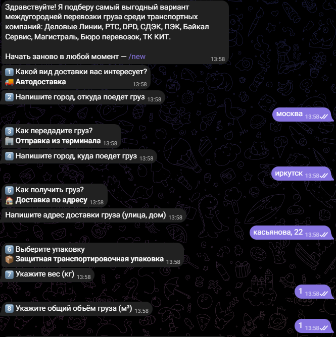
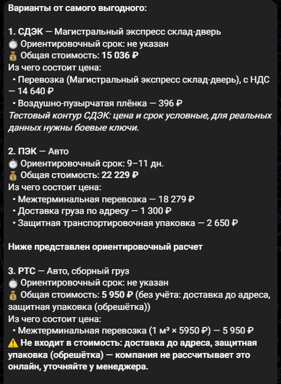
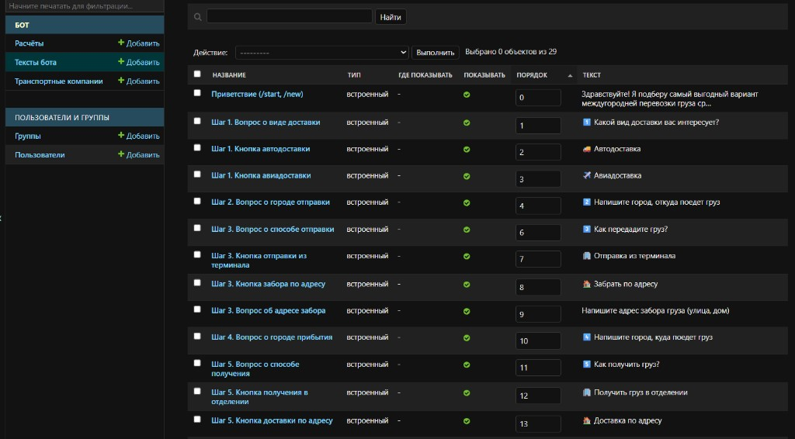
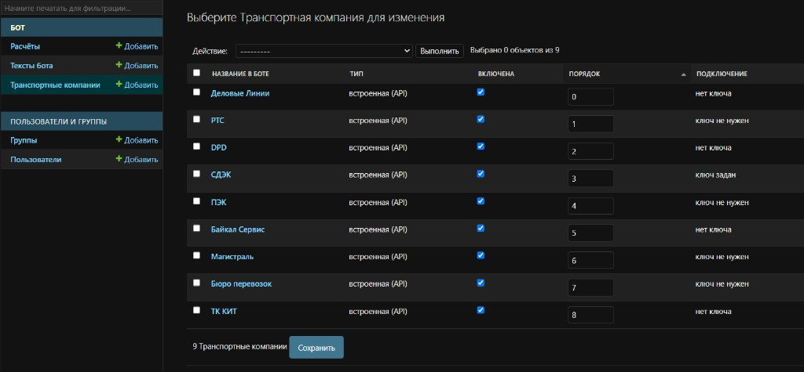

# ТГ чат-бот для подбора транспортной компании

Telegram-бот для логистов: по параметрам груза запрашивает расчёт у транспортных компаний
и показывает варианты от самого выгодного — с ориентировочным сроком и разбивкой стоимости.

Компании: Деловые Линии, РТС, DPD, СДЭК, ПЭК, Байкал Сервис, Магистраль, Бюро перевозок, ТК КИТ.

Стек: Python 3.11+, Django 5.2 (админка, база), aiogram 3 (Telegram), httpx, zeep (SOAP для DPD).

## Диалог с ботом

1. Вид доставки — авто или авиа.
2. Город отправки.
3. Отправка из терминала или забор по адресу (тогда бот спросит адрес).
4. Город прибытия.
5. Получение в отделении или доставка по адресу (тогда бот спросит адрес).
6. Упаковка — защитная, палетирование или без упаковки.
7. Вес, кг.
8. Объём, м³.

Начать заново — команда `/new`.

<p>
  
  
</p>

## ⚠️ API-ключи транспортных компаний

**Для расчёта в Деловых Линиях, DPD, Байкал Сервисе и ТК КИТ необходимо добавить API-ключи.**
Без них эти компании в ответе бота попадают в строку «Не подключены (нет ключа API)».


Остальные компании:

- **ПЭК, РТС** — ключ не нужен, используются публичные калькуляторы. Цена ПЭК ориентировочная:
  публичный калькулятор не учитывает страхование, мешок и пломбировку.
  Для точных цен нужен официальный API ПЭК (логин и ключ из личного кабинета kabinet.pecom.ru).
- **СДЭК** — нужны Client ID и Client Secret из личного кабинета СДЭК (раздел «Интеграция»).
  С тестовыми ключами и адресом `https://api.edu.cdek.ru/v2` цена и срок условные.
- **Магистраль, Бюро перевозок** — онлайн-расчёта нет, бот показывает контакты менеджера.


## Запуск

Бот и админка — две отдельные программы, запускаются в разных терминалах
(в каждом сначала активируйте окружение: `source .venv/Scripts/activate`).

```bash
python manage.py runbot      # бот
python manage.py runserver   # админка: http://127.0.0.1:8000/admin/
```


## Админка

- **Тексты бота** — все сообщения и надписи на кнопках. Пустое поле возвращает текст по умолчанию.
  Можно добавлять свои сообщения: после приветствия, перед результатами или после них.
- **Транспортные компании** — включение/выключение, порядок, название, контакты, API-ключи.
  Можно добавить свою компанию без API: бот покажет её контакты вместо расчёта.
  Встроенные компании удалить нельзя — только выключить.
- **Расчёты** — история запросов пользователей и результаты.

Тексты бота:



Транспортные компании:




